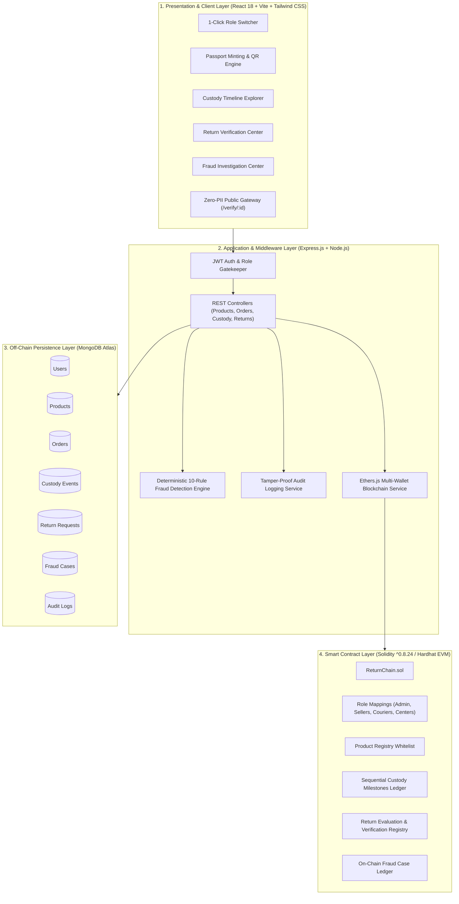

# ReturnChain 🔗🛡️
### Blockchain-Based Product Identity and Chain-of-Custody System for E-Commerce Return Fraud Prevention

[](https://soliditylang.org/)
[](https://hardhat.org/)
[](https://react.dev/)
[](https://nodejs.org/)
[](https://www.mongodb.com/)
[](https://tailwindcss.com/)
[](LICENSE)

---

## 📌 Academic & Project Metadata

* **Project Title:** ReturnChain: Blockchain-Based Product Identity and Chain-of-Custody System for E-Commerce Return Fraud Prevention
* **Student Name:** **CHUNDURI HARI KRISHNA**
* **Roll Number / Reg. No:** **23502A0529**
* **Degree & Program:** Bachelor of Technology in Computer Science and Engineering
* **Course Code & Title:** 23CS4701B – Blockchain Technology (Assignment-2)
* **Academic Year & Semester:** 2026–2027 (Semester 4-1)
* **Faculty Guide:** **Mr. A. Prashant**, Assistant Professor, Dept. of CSE
* **Head of the Department:** **Dr. A. Jayalakshmi**, Professor & Head, Dept. of CSE
* **Institution:** **Prasad V Potluri Siddhartha Institute of Technology (PVPSIT)**, Kanuru, Vijayawada – 520007  
  *(Permanently affiliated to JNTU-Kakinada, Approved by AICTE, NBA & NAAC Accredited, ISO 9001:2015 Certified)*

---

## 🔗 Quick Resource & Submission Links

* 🎥 **Video Presentation Link:**  
  👉 **[Watch Project Demonstration Video](https://drive.google.com/file/d/15377xtzfBLrpEmr5hEKREk8y44TWsu3U/view?usp=sharing)**  
  *(Direct Google Drive Video Link: `https://drive.google.com/file/d/15377xtzfBLrpEmr5hEKREk8y44TWsu3U/view?usp=sharing`)*

* 🐙 **Official GitHub Repository:**  
  👉 **[https://github.com/HARICH529/Blockchain](https://github.com/HARICH529/Blockchain)**

* 📄 **Comprehensive Academic Documentation:**  
  👉 Read the complete 11-chapter formal project report below or browse **[docs/RETURNCHAIN_DOCUMENTATION.md](docs/RETURNCHAIN_DOCUMENTATION.md)**.

---

## 💡 Executive Summary

**ReturnChain** is a full-stack, enterprise-grade decentralized web application built to eliminate the multi-billion dollar problem of e-commerce return fraud—including **product substitution ("brick-in-the-box")**, **counterfeit knockoff swaps**, **damaged component-stripped returns**, and **duplicate return claims**.

> **Core Engineering Axiom:**  
> *Verify the physical product and its immutable cryptographic chain-of-custody, not just the order number or external package barcode.*

```
+--------------------------------------------------------------------------------------------------+
|                                    RETURNCHAIN CORE INNOVATION                                   |
+--------------------------------------------------------------------------------------------------+
|  1. Digital Product Identity Passports anchored on EVM smart contracts.                         |
|  2. 11-Milestone Cryptographic Chain-of-Custody tracking every hand-off from factory to intake.   |
|  3. Deterministic 10-Rule Fraud Detection Engine evaluating returned items in milliseconds.     |
|  4. Strict Multi-Role Access Control (Admin, Seller, Courier, Return Center, Customer).         |
|  5. Privacy-Preserving Zero-PII Public Verification Gateway via dynamic QR tags.                 |
+--------------------------------------------------------------------------------------------------+
```

---

## 🌟 Key Architectural Features

1. **Digital Product Identity Passports:**
   - Every physical item is minted as an on-chain digital passport (`RC-PROD-XXXX`) tied to its unique manufacturer serial number and a Keccak-256 specification hash.
   - Dynamic QR codes resolve to a public verification gateway (`/verify/:id`) with authenticity proof, lifecycle status, and warnings—with **zero personally identifiable information (PII)** exposed.

2. **11-Milestone Cryptographic Chain-of-Custody:**
   - Sequential, tamper-proof tracking across all delivery and return stages:
     `REGISTERED` ➔ `ASSIGNED_WAREHOUSE` ➔ `DISPATCHED` ➔ `COURIER_PICKUP` ➔ `IN_TRANSIT` ➔ `DELIVERED` ➔ `RETURN_REQUESTED` ➔ `RETURN_IN_TRANSIT` ➔ `RETURN_RECEIVED` ➔ `INSPECTED` ➔ `RETURN_VERIFIED / FLAGGED`
   - State transitions are strictly enforced in both Solidity contract modifiers and backend middleware.

3. **Deterministic 10-Rule Fraud Detection Engine:**
   - Automatically cross-examines incoming physical items against on-chain records and generates clear verdicts:
     - 🟢 **VERIFIED (GREEN):** Identity, serial number, and custody chain consistent; authorizes immediate customer refund.
     - 🔴 **SUSPICIOUS (RED):** Product substitution or counterfeit swap detected; halts refund and logs audited `FraudCase` on-chain.
     - 🟡 **MANUAL REVIEW (AMBER):** Physical seal discrepancies or shipping damage requiring administrative arbitration.

4. **Multi-Role Governance & 1-Click Academic Switcher:**
   - Full support for 5 distinct roles: **Admin**, **Seller**, **Courier**, **Return Center Inspector**, and **Customer**.
   - Built-in 1-Click Role Switcher in the top navigation bar for seamless live demonstrations.

5. **Live Audit Explorer & Blockchain Tracker:**
   - Displays real-time Hardhat EVM network parameters, block numbers, transaction hashes, gas consumption, and emitted smart contract events.

---

## 🛠️ Technology Stack

| Layer | Technologies & Tools |
| :--- | :--- |
| **Smart Contracts & EVM** | Solidity (`^0.8.24`), Hardhat (`v2.22.x`), Ethers.js (`v6.13.x`), Local Hardhat EVM Node |
| **Backend API Server** | Node.js (`v20.x`), Express.js (`v4.19.x`), Mongoose (`v8.x`), JWT, bcryptjs, CORS, Morgan |
| **Off-Chain Database** | MongoDB Atlas / Local MongoDB Server |
| **Frontend Web Application** | React 18, Vite, Tailwind CSS, Lucide React icons, Recharts, React Router DOM, Axios |
| **Automated Testing** | Mocha, Chai, 20 automated passing smart contract test assertions |

---

## 👥 Seeded Demonstration Accounts

All demo accounts share the default password: **`password123`**

| Role | Email | Name / Organization | Permissions & Responsibilities |
| :--- | :--- | :--- | :--- |
| **Admin** | `admin@returnchain.io` | Security Administrator | Full platform oversight, fraud case resolution, user governance, audit trail |
| **Return Center** | `inspector@returncenter.com` | Chicago Return Hub | Intake bay check-in, physical item inspection, 10-rule fraud checking |
| **Seller** | `seller@apple.com` | Apex Electronics (Authorized Seller) | Product registration & passport minting, order dispatch, custody logging |
| **Courier** | `courier@fedex.com` | SwiftLogistics Express | Transit pickup, checkpoint updates, electronic delivery confirmation |
| **Customer** | `customer@gmail.com` | Sarah Jenkins (Buyer) | Order history, return request submission, refund tracking |

---

## 🚀 Quickstart Installation & Setup

### Prerequisites
* [Node.js](https://nodejs.org/) (v18 or v20 LTS)
* [Git](https://git-scm.com/)
* [MongoDB](https://www.mongodb.com/) (Local server or MongoDB Atlas free cluster)

---

### Step 1: Clone the Repository
```bash
git clone https://github.com/HARICH529/Blockchain.git
cd Blockchain
```

---

### Step 2: Configure Environment Variables

The project includes pre-configured `.env.example` templates. 

Copy `.env.example` to `backend/.env`:
```bash
cp .env.example backend/.env
```

Your `backend/.env` should contain:
```ini
PORT=5000
MONGODB_URI=mongodb://127.0.0.1:27017/returnchain
JWT_SECRET=returnchain_jwt_secret_secure_key_2026_production
RPC_URL=http://127.0.0.1:8545
NODE_ENV=development
FRONTEND_URL=http://localhost:3000
```
> *(If using MongoDB Atlas, replace `MONGODB_URI` with your own cluster connection string: `mongodb+srv://<username>:<password>@cluster0.mongodb.net/returnchain`)*

---

### Step 3: Install Dependencies
Install all root, backend, blockchain, and frontend dependencies:
```bash
npm install
npm run install:all
```

---

### Step 4: Run the Application (4 Simple Terminal Windows)

#### Terminal 1 — Start Local Blockchain Node
```bash
npm run node
```
*Starts a local Hardhat Ethereum node on `http://127.0.0.1:8545` with 20 prefunded test accounts.*

#### Terminal 2 — Deploy Smart Contract
```bash
npm run deploy
```
*Compiles `ReturnChain.sol`, deploys it to the local EVM node, configures initial demo roles, and syncs contract address and ABI to backend and frontend configs.*

#### Terminal 3 — Seed Database & Start Backend Server
```bash
# Seed initial demo products, orders, and users
npm run seed

# Start the Express API server
npm run start:backend
```
*Backend server starts on `http://localhost:5000`.*

#### Terminal 4 — Start Frontend Web Application
```bash
npm run start:frontend
```
*Frontend client starts on `http://localhost:3000`.*

Open your browser to: **`http://localhost:3000`**

---

## 🧪 Demonstration Scenarios

Use the **1-Click Role Switcher** at the top right of the navigation bar to execute these scenarios:

### Scenario A: Genuine Return (Passes 10/10 Rules)
1. Switch to **Customer** (`customer@gmail.com`) ➔ View Orders ➔ Request Return on iPhone 15 Pro (`RC-PROD-1001`).
2. Switch to **Courier** (`courier@fedex.com`) ➔ Pick up package ➔ Update custody status to `RETURN_IN_TRANSIT`.
3. Switch to **Return Center** (`inspector@returncenter.com`) ➔ Open Verification Center.
4. Select Return `RC-RET-8001` ➔ Scan QR tag (`RC-PROD-1001`) ➔ Enter genuine serial `SN-IPHONE15-88219`.
5. Check all physical seals as intact ➔ Click **Execute Verification & Fraud Check**.
6. **Result:** 🟢 **VERIFIED (GREEN)** — Smart contract emits `ReturnVerified`, and refund is approved instantly.

### Scenario B: Counterfeit Substitution Fraud Detection
1. Select a return request in the Verification Center.
2. Enter an incorrect or mismatched serial number (e.g., counterfeit unit `SN-FAKE-99999`).
3. Click **Execute Verification & Fraud Check**.
4. **Result:** 🔴 **SUSPICIOUS (RED)** — The 10-rule engine triggers `SERIAL_MISMATCH` (Risk: **CRITICAL**), blocks the refund, emits `FraudFlagged` on-chain, and queues an audited fraud case for Admin review.

---

# 📚 COMPLETE PROJECT DOCUMENTATION (USE CASE REPORT)

The sections below contain the complete formal documentation matching the university-submitted project report for **CHUNDURI HARI KRISHNA (23502A0529)**.

---

## Chapter 1: Introduction

### 1.1 Overview of Blockchain Technology
Blockchain technology is an append-only, distributed ledger system that records transactions across a peer-to-peer network of computers without requiring a centralized clearinghouse. Transactions are grouped into cryptographically verified blocks, and each block contains the hash of the previous block, forming an unbroken, tamper-evident chain of records.

Unlike a conventional relational database, where administrative accounts can update or delete records, a blockchain provides immutability, distributed consensus, and cryptographic provenance. Smart contracts, which are programs executed uniformly by every node of the network, enforce business rules and state transitions automatically. In the ReturnChain project, blockchain is used to record the identity of each physical product and every custody hand-off that the product undergoes, so that the product’s journey from seller to customer and back to a return center can be verified independently.

### 1.2 Relevance of Blockchain in E-Commerce Return Fraud Prevention
The rapid growth of e-commerce has been accompanied by a large increase in return fraud and retail abuse, costing retailers heavy financial losses every year. Common fraud patterns include:
* **Product substitution (“brick-in-the-box”):** A customer buys an authentic high-value item, such as a phone, graphics card, or watch, and returns an older model, a broken replica, or a weighted placeholder inside the original packaging.
* **Counterfeit swapping:** Authentic components or whole units are replaced with counterfeit alternatives before the item is returned for a full refund.
* **Duplicate return claims:** Delays between courier systems and merchant databases are exploited to claim multiple refunds for a single order.

Traditional return logistics rely on separate, centralized databases managed by merchants, third-party couriers, and return processing centers. These systems suffer from record alteration by malicious insiders or compromised API tokens, incomplete audit logs that cannot show where a product was substituted, and an over-reliance on visual inspection by warehouse staff who have no cryptographic means of verifying the authenticity of a serialized item.

ReturnChain addresses these weaknesses by changing what is verified. Instead of trusting only the order number or the package barcode, the system verifies the physical product and its immutable chain of custody. Each physical unit receives a unique digital product passport that is anchored to a Solidity smart contract when the seller registers it. All eleven custody milestones of the outbound delivery and the inbound return are committed to the ledger. When a returned item reaches the intake bay, a deterministic 10-rule fraud detection engine compares its physical serial number, product identity, and recorded custody states against the blockchain record before any refund is authorized.

---

## Chapter 2: Background & Problem Statement

Traditional e-commerce return handling depends on siloed databases, barcode-based tracking, and manual inspection performed under time pressure. These characteristics create opportunities for fraud, weaken accountability between the parties involved, and lead to financial losses for merchants.

```
+-----------------------------------------------------------------------------------------+
|                               LEGACY RETURN INFRASTRUCTURE                              |
+-----------------------------------------------------------------------------------------+
|  [Seller DB]            [Courier Carrier DB]          [Return Warehouse DB]             |
|   - Order #8021          - Tracking #SW-101            - Return Intake #R-99            |
|   - Internal SKU         - Status: "Delivered"         - Status: "Received"             |
|         |                        |                             |                        |
|         +------------> [MUTABLE SILOED DATABASES] <------------+                        |
|                                  |                                                      |
|         × Open to unauthorized administrator edits and injection attacks                |
|         × No cryptographic proof of serial number or custody continuity                 |
|         × Scanned package barcode is disconnected from the physical item inside         |
+-----------------------------------------------------------------------------------------+
```

### 2.1 Product Substitution and Serial Number Swapping
In legacy systems, return approval is tied to the tracking barcode of the return package rather than to the serialized identity of the product inside. Bad actors exploit this gap by purchasing a genuine electronic item and placing an identical counterfeit, or an older defective model, inside the retail box before returning it for a full refund.

### 2.2 Counterfeit Knockoff Infiltration
Counterfeiters can manufacture packaging that is identical to the original. Centralized systems lack a unified, non-reproducible cryptographic whitelist, so when intake staff scan the external UPC/EAN barcode the database validates only the general SKU. Knockoff units can therefore enter secondary resale inventories without being noticed.

### 2.3 Damaged and Component-Stripped Returns
Products from which internal parts have been removed, such as RAM modules, optical lenses, or GPU heatsinks, are often returned as “defective out of the box”. Without baseline specification hashes recorded at the factory, return centers cannot prove whether the item arrived defective or was stripped after delivery.

### 2.4 Duplicate Return Submissions and Double Refunds
Centralized databases often operate asynchronously. Gaps between customer-service ticket queues, warehouse management systems (WMS), and enterprise resource planning (ERP) software allow dishonest buyers to submit duplicate return requests or trigger refunds through several channels for the same item.

### 2.5 Return Requests Prior to Outbound Delivery
Fraudulent accounts exploit API delays to file return and refund requests while a shipment is still in transit, claiming non-delivery while the physical parcel is intercepted at the delivery point.

### 2.6 Custody Blind Spots Across Carrier Hand-offs
When an item moves between suppliers, line-haul carriers, local couriers, and return hubs, custody logs are kept in proprietary carrier systems. If an item is damaged or swapped, the merchant cannot identify whether the compromise occurred under courier custody or at the warehouse intake dock.

### 2.7 Unauthorized Centralized Database Tampering
Database administrators, compromised support accounts, or other actors with direct database access can modify order statuses, erase fraud flags, or mark returned items as “inspected” without any physical verification having been carried out.

### 2.8 Disconnected Manufacturer, Courier, and Warehouse Systems
Logistics stakeholders use isolated technology stacks such as EDI, proprietary REST APIs, and legacy SOAP endpoints. This fragmentation prevents real-time synchronization of serial-level custody transitions between organizations.

### 2.9 Inadequate Physical Inspection Criteria
Warehouse intake workers process hundreds of return packages per hour under strict performance quotas. Without a standardized, rule-based verification protocol linked to recorded custody milestones, inspections are subjective and error-prone.

### 2.10 Absence of Zero-PII Public Verifiable Provenance
Buyers in secondary markets, such as refurbished goods and peer-to-peer exchanges, cannot verify whether an item was legally acquired, previously repaired, or involved in return fraud. Exposing order histories in centralized systems would violate data privacy regulations such as GDPR and CCPA, so no public verification is offered at all.

---

## Chapter 3: Blockchain Basics & Cryptographic Foundations

### 3.1 Distributed Ledger Architecture
ReturnChain replaces isolated databases with a shared state machine running on the Ethereum Virtual Machine (EVM). Every node maintains an identical, cryptographically synchronized state, which removes single points of failure and gives the seller, courier, and return center one common source of truth.

### 3.2 Cryptographic Immutability and Keccak-256 Hashing
Every data payload, such as product metadata, courier location data, or inspection results, can be converted into a deterministic 256-bit fingerprint using the Keccak-256 algorithm:

$$\text{ProductHash} = \text{Keccak-256}(\text{ProductId} \parallel \text{SerialNumber} \parallel \text{ManufacturerData})$$

Once this hash is stored in the smart contract’s state, it cannot be altered, overwritten, or erased by any network participant. A change of even one character in the source data produces a completely different hash.

### 3.3 Verifiable Transparency and Event Auditing
Smart contracts emit events such as `ProductRegistered`, `CustodyUpdated`, `ReturnVerified`, and `FraudFlagged`. These events are written to the transaction receipts of the blockchain and form an immutable audit log that can be indexed and queried using Ethers.js.

### 3.4 Smart Contracts
ReturnChain uses smart contracts written in Solidity (`^0.8.24`) to enforce business rules directly on the blockchain. A state change, such as marking a return as verified, is executed only if its prerequisites are satisfied. For example, the verdict can be recorded only for an existing return that is still in the `PENDING` state and only by an authorized return center.

### 3.5 Consensus Mechanisms and Hardhat Network Execution
Consensus mechanisms allow network participants to agree on the order of valid transactions. For enterprise logistics, models such as Proof of Authority (PoA) or Proof of Stake (PoS) provide fast finality without the energy cost of Proof of Work. The ReturnChain prototype runs on a local Hardhat EVM node, which provides sub-second block times and deterministic state transitions for integration testing.

### 3.6 Role-Based Access Control and Digital Signatures
Every state-changing contract method requires a transaction signed with the Elliptic Curve Digital Signature Algorithm (ECDSA, secp256k1). Access is restricted using Solidity modifiers:
* `onlyAdmin`: contract configuration, fraud resolution, and role governance.
* `onlySeller`: product passport registration and initial dispatch.
* `onlyCourier`: transit milestone updates and delivery confirmation.
* `onlyReturnCenter`: intake check-in, inspection, and verification verdicts.

### 3.7 Hybrid Architecture: On-Chain Anchors and Off-Chain Storage
To optimize gas cost while preserving integrity, ReturnChain splits data between two stores:
* **Off-chain (MongoDB Atlas):** large JSON payloads, high-resolution inspection photographs, detailed shipping manifests, and user credentials.
* **On-chain (Solidity contract):** unique identity strings, status enums, actor Ethereum addresses, block timestamps, and Keccak-256 hashes of the off-chain records.

---

## Chapter 4: Use Case Overview & Architecture

### 4.1 Objectives
* **Anchor product identity:** Mint an immutable on-chain digital passport for every physical unit, preventing counterfeit duplication.
* **Track custody transitions:** Log all 11 lifecycle milestones across the outbound and inbound logistics legs.
* **Automate fraud detection:** Execute an automated 10-rule verification engine at return intake before any refund is processed.
* **Enforce role-based governance:** Restrict each action to authorized actors through smart contract modifiers.
* **Protect user privacy:** Offer public QR-code verification with zero exposure of personally identifiable information (PII).

### 4.2 System Architecture (4-Tier Model)



### 4.3 Deterministic 10-Rule Fraud Detection Engine

| Rule Identifier | Failure Condition | Assigned Risk Level | Operational Meaning |
| :--- | :--- | :--- | :--- |
| **`UNREGISTERED_PRODUCT`** | Scanned ID does not exist in contract storage. | **CRITICAL** | Item was never manufactured or sold through the platform. |
| **`PRODUCT_ID_MISMATCH`** | Scanned product ID differs from the return request. | **CRITICAL** | **Substitution fraud:** a different item was placed in the package. |
| **`SERIAL_MISMATCH`** | Physical serial differs from the genesis passport. | **CRITICAL** | **Counterfeit swap:** knockoff unit placed in authentic packaging. |
| **`WRONG_ORDER_ASSOCIATION`** | Product is bound to a different customer order. | **HIGH** | Product was swapped with an item from another order. |
| **`DUPLICATE_RETURN_REQUEST`** | An approved or active return already exists for this unit. | **HIGH** | Attempt to claim multiple refunds for one purchase. |
| **`RETURN_BEFORE_DELIVERY`** | Custody timeline lacks a verified `DELIVERED` milestone. | **CRITICAL** | Return attempted while the item is still in transit. |
| **`INVALID_CUSTODY_TRANSITION`**| Custody sequence violates the lifecycle state machine. | **MEDIUM** | A state transition bypassed normal carrier checkpoints. |
| **`MISSING_EXPECTED_CUSTODY`** | Mandatory pickup or transit checkpoints are missing. | **MEDIUM** | Missing hand-off scans suggest shipment tampering. |
| **`RETURN_ALREADY_COMPLETED`** | Linked return request is already `REFUNDED`. | **HIGH** | Attempt to process a previously closed return. |
| **`PHYSICAL_INSPECTION_CONFLICT`**| Physical condition contradicts customer claim (broken seals, etc.).| **MEDIUM (AMBER)** | Item returned damaged, missing parts, or stripped internally. |

---

## Chapter 5: Implementation & Code Reference

### Core Solidity Smart Contract: `ReturnChain.sol`

```solidity
// SPDX-License-Identifier: MIT
pragma solidity ^0.8.24;

contract ReturnChain {
    address public admin;
    mapping(address => bool) public sellers; 
    mapping(address => bool) public couriers; 
    mapping(address => bool) public returnCenters;

    enum ProductStatus {
        REGISTERED,          // 0: Created by seller 
        ASSIGNED_WAREHOUSE,  // 1: Allocated to warehouse staging 
        DISPATCHED,          // 2: Dispatched for outbound delivery 
        IN_TRANSIT,          // 3: In transit by courier
        DELIVERED,           // 4: Delivered to customer 
        RETURN_REQUESTED,    // 5: Return filed by customer 
        RETURN_IN_TRANSIT,   // 6: Return parcel in transit 
        RETURN_RECEIVED,     // 7: Intake bay receipt at Return Center 
        RETURN_VERIFIED,     // 8: Inspected and verified genuine 
        RETURN_FLAGGED,      // 9: Flagged as fraud / mismatch
        REFUNDED             // 10: Refund authorized and settled
    }

    enum VerificationResult { PENDING, VERIFIED, SUSPICIOUS, MANUAL_REVIEW }
    enum FraudRiskLevel { LOW, MEDIUM, HIGH, CRITICAL }

    struct CustodyEvent {
        string eventType;
        address actor;
        string actorRole;
        string location;
        bytes32 dataHash;
        uint256 timestamp;
    }

    struct Product {
        string productId;
        string serialNumber;
        bytes32 productHash;
        address seller;
        ProductStatus status;
        uint256 registeredAt;
        bool exists;
    }

    struct ReturnItem {
        string returnId;
        string productId;
        string orderId;
        address customer;
        string reason;
        VerificationResult outcome;
        bytes32 inspectionNotesHash;
        uint256 createdAt;
        uint256 verifiedAt;
        bool exists;
    }

    mapping(string => Product) private products; 
    mapping(string => CustodyEvent[]) private productCustody; 
    mapping(string => ReturnItem) private returnItems; 
    mapping(string => string) private serialToProductId;

    modifier onlyAdmin() {
        require(msg.sender == admin, "ReturnChain: Caller is not Admin");
        _;
    }

    modifier onlySeller() {
        require(sellers[msg.sender] || msg.sender == admin, "ReturnChain: Caller is not an authorized Seller");
        _;
    }

    modifier onlyCourier() {
        require(couriers[msg.sender] || msg.sender == admin, "ReturnChain: Caller is not an authorized Courier");
        _;
    }

    modifier onlyReturnCenter() {
        require(returnCenters[msg.sender] || msg.sender == admin, "ReturnChain: Caller is not an authorized Return Center");
        _;
    }

    function registerProduct(
        string calldata productId, 
        string calldata serialNumber, 
        bytes32 productHash,
        string calldata initialLocation
    ) external onlySeller {
        require(!products[productId].exists, "ReturnChain: Product already registered");
        require(bytes(serialToProductId[serialNumber]).length == 0, "ReturnChain: Serial number already registered");

        products[productId] = Product({
            productId: productId,
            serialNumber: serialNumber, 
            productHash: productHash,
            seller: msg.sender, 
            status: ProductStatus.REGISTERED,
            registeredAt: block.timestamp,
            exists: true
        });

        serialToProductId[serialNumber] = productId;

        productCustody[productId].push(CustodyEvent({
            eventType: "REGISTERED",
            actor: msg.sender,
            actorRole: "SELLER", 
            location: initialLocation,
            dataHash: productHash,
            timestamp: block.timestamp
        }));
    }
}
```

---

## Chapter 6: Strategic Benefits

1. **Elimination of Product Substitution Fraud:** Instant detection of swapped or knockoff hardware.
2. **End-to-End Custody Visibility:** Identifies the precise carrier and handover checkpoint where damage or theft occurred.
3. **Automated Rule-Based Decision Automation:** Standardizes intake inspections and removes subjective bias.
4. **Zero-PII Privacy Protection:** Guarantees compliance with GDPR/CCPA by keeping customer identity off public ledgers.
5. **Mitigation of Internal Database Tampering:** Verifications anchored on-chain cannot be altered in relational databases.
6. **Accelerated Customer Refunds:** Honest customers receive instant automated refunds upon intake pass.

---

## Chapter 7: Challenges & Mitigations

* **Physical Tag Tampering:** Mitigated using destructible tamper-evident QR adhesive stickers and embedded NFC chips.
* **EVM Gas Costs:** Mitigated via Layer-2 rollups (Polygon/Arbitrum) or enterprise Proof-of-Authority (PoA) chains.
* **Legacy ERP Integration:** Standard RESTful webhooks and message queues (RabbitMQ/Kafka) synchronize legacy systems.
* **Private Key Security:** Enterprise HSMs (AWS KMS / HashiCorp Vault) and multi-signature authorization protect system wallets.

---

## Chapter 8: Conclusion & Future Scope

ReturnChain successfully replaces vulnerable, order-based return systems with a decentralized product identity and chain-of-custody platform. Future enhancements will integrate **computer-vision AI** for automated physical damage assessment, **encrypted silicon NFC tags** embedded directly in hardware components, and **Layer-2 zero-knowledge rollups** for ultra-high throughput cross-border logistics.

---

## Chapter 9: UN Sustainable Development Goals (SDGs) Addressed

* **SDG 12: Responsible Consumption & Production (Target 12.5):** Facilitates verified circular resale, preventing millions of viable returned goods from being discarded into landfills.
* **SDG 9: Industry, Innovation, and Infrastructure (Target 9.1 & 9.b):** Upgrades global retail logistics infrastructure using blockchain and smart contracts.
* **SDG 16: Peace, Justice, and Strong Institutions (Target 16.5 & 16.6):** Eliminates retail fraud and organized retail crime through auditable custody ledgers.

---

## Chapter 10: Academic References

1. **Wood, G. (2014).** *Ethereum: A Secure Decentralised Generalised Transaction Ledger (Yellow Paper).*
2. **Solidity Documentation (v0.8.24).** *Ethereum Developer Platform.*
3. **Hardhat Development Framework.** *Nomic Foundation.*
4. **Ethers.js Client Library (v6).**
5. **National Retail Federation (NRF) & Appriss Retail (2023).** *Consumer Returns in the Retail Industry.*
6. **NIST Special Publication 800-207.** *Zero Trust Architecture.*
7. **United Nations.** *The 17 Sustainable Development Goals (SDGs).*

---

## Chapter 11: Appendix A: Presentation & Code Links

* 🎥 **Video Presentation:** [https://drive.google.com/file/d/15377xtzfBLrpEmr5hEKREk8y44TWsu3U/view?usp=sharing](https://drive.google.com/file/d/15377xtzfBLrpEmr5hEKREk8y44TWsu3U/view?usp=sharing)
* 🐙 **GitHub Repository:** [https://github.com/HARICH529/Blockchain](https://github.com/HARICH529/Blockchain)

---

## 🔒 Security & Privacy Notice
* Real `.env` files, MongoDB connection credentials, and private keys are strictly excluded from version control via `.gitignore`.
* This repository is safely configured to be pushed to [https://github.com/HARICH529/Blockchain](https://github.com/HARICH529/Blockchain) with zero confidential credentials exposed.
