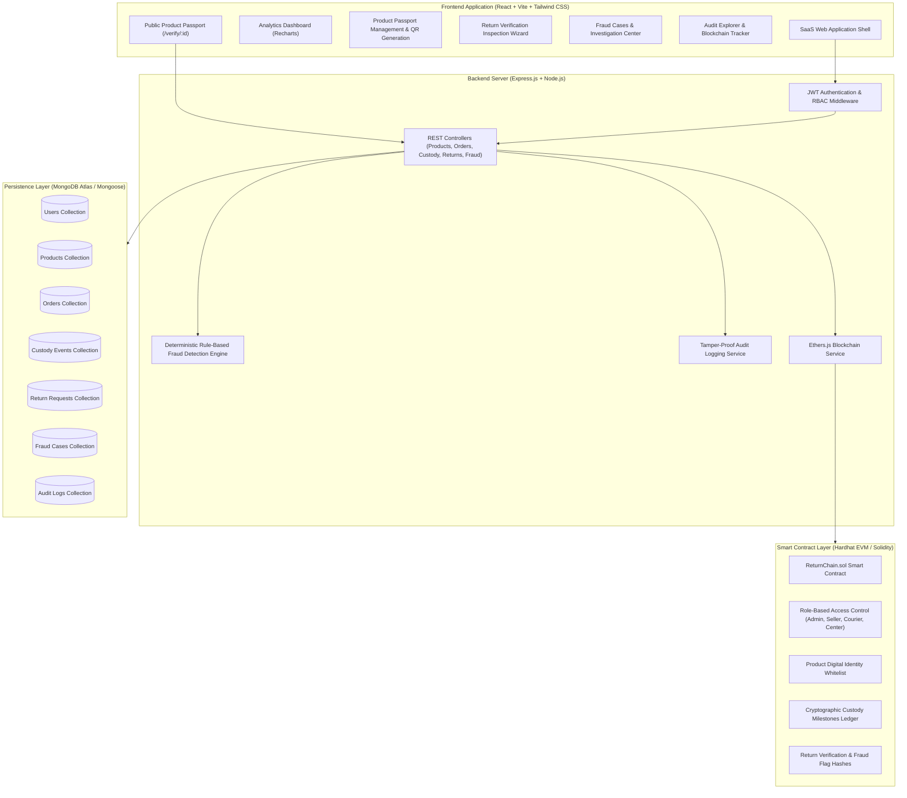
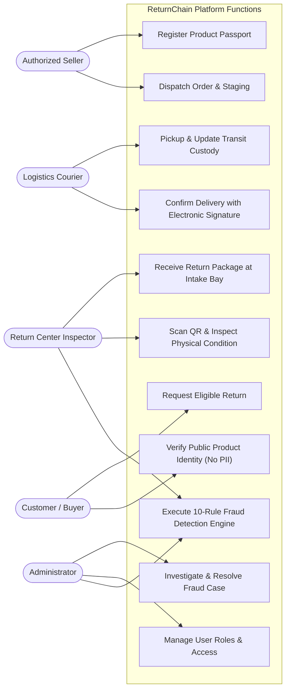
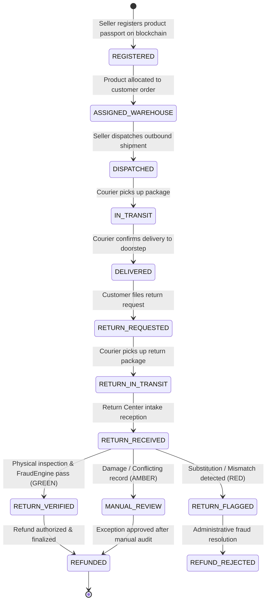
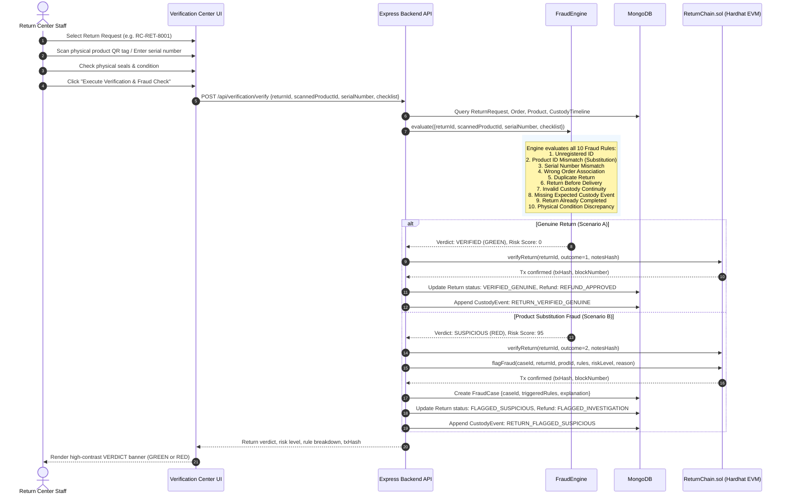
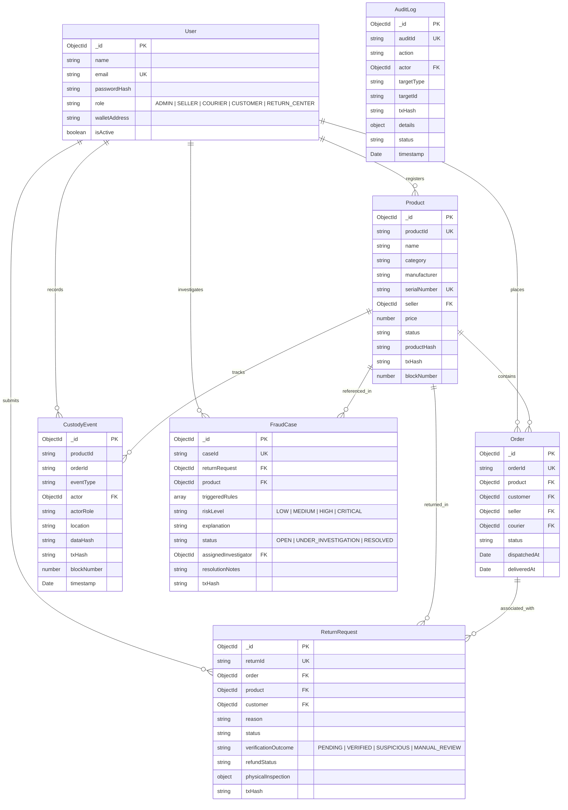

# ReturnChain: Architectural Diagrams & Specifications

This document contains editable Mermaid diagrams illustrating the ReturnChain architecture, lifecycle state transitions, data relationships, and the return inspection sequence.

---

## 1. System Architecture Diagram

---

## 2. Use-Case Diagram

---

## 3. Product Lifecycle State Diagram

---

## 4. Return Verification Sequence Diagram

---

## 5. Database Entity Relationship (ER) Diagram

